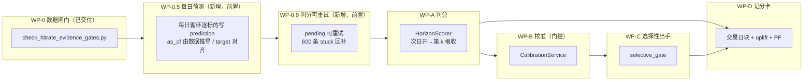
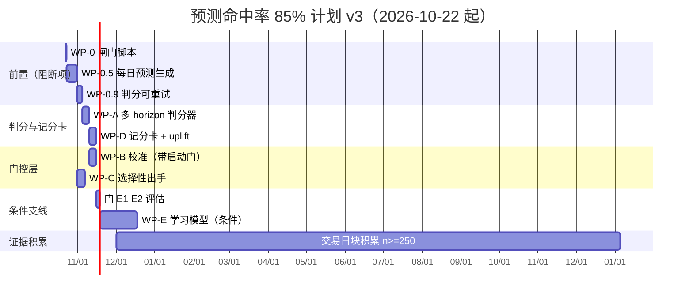

# 预测命中率 ≥85% 开发方案

| 项 | 内容 |
|---|---|
| 文档版本 | **v3（认证后的修订版）** |
| 认证日期 | 2026-10-21 |
| 前序版本 | v2 已归档至 `docs/archive/PREDICTION_HITRATE_85_PLAN_v2.md` |
| 认证脚本 | `scripts/check_hitrate_evidence_gates.py`（只读，可复现） |
| 认证快照 | `docs/archive/hitrate_gates_2026-10-21.json` |
| 数据基线 | `~/.aiask/data/db/akshare_mcp.sqlite3`，`kline_1d` 最新 bar = **2026-10-16** |
| 运行环境 | `/opt/miniconda3/envs/aiask/bin/python` |

> **本文与 v2 的关系**：v2 的架构分层（判分 → 校准 → 选择性出手 → 记分卡）是正确的，
> 保留。v3 重写的是**目标定义、前提验证顺序和样本量算法**，因为 v2 有五个前提经实测不成立。
> 每一个被推翻的前提都在下文给出脚本输出，可用一条命令复现。

---

## 0. 认证摘要（先读）

### 0.1 一句话结论

**按 v2 的目标定义（净收益方向命中 ≥85%，n≥200，LCB>0.80），当前数据上不可达。** 同时，
现有的信号源与数据链路都不足以开始校准。但 85% 并非在所有定义下都不可达——它在两个更弱的
口径下现在就能达到，只是那两个口径**同时亏钱**。因此下一步不是"写校准层"，而是
**先冻结一个"既可达又不亏钱"的判据，再按证据闸门逐级放行**。

### 0.2 三种"85%"的实测

| 口径 | 实测可达性 | 代价 | 判定 |
|---|---|---|---|
| **A. 净收益方向**（v2 口径：次日开入场、扣 0.21%、持平带 0.2%） | 全市场无条件基准 5d 0.31 / 20d 0.30；选股后最好 0.47 | — | **不可达** |
| **B. 亏损不超过 −8%**（"没亏太多"） | 低波动 20% 内取动量第一名：2025 **87.2%**、2026 **75.4%** | 2025 均值 **−5.33%**、PF **0.01**；2026 均值 −5.50% | **达标即亏钱** |
| **C. 止盈优先**（TP+1% / SL−10%） | 无条件 **90.2%** | PF **0.83**、均值 **−0.15%** | **达标即亏钱** |

口径 B 与 C 正是 v2 §10.1 列出的风险「高胜率低盈亏比」的实证版本。**任何只报命中率、
不并行报告 PF 与净收益 LCB 的记分卡，都会把这两种骗局认证为成功。**

### 0.3 五个被推翻的 v2 前提

| # | v2 前提 | 实测 | 结论 |
|---|---|---|---|
| P1 | 每日循环逐标的产生预测（§3、§6） | 8,932 条预测 / **8,932 个不同 strategy_id**；547 笔纸面单中匹配"同策略同标的 target 日"的 **0 笔**，匹配窗口内的 56 笔 | 链路不存在，WP-C 需前置工作包 |
| P2 | 独立块 `(code, as_of)` 可在数月内到 n≥200（§7） | 全库只有 **87 个块**、7 个 as_of 日期；块内 horizon 窗口重叠 4–19 天 | Wilson 的 iid 假设不成立，且块数不可达 |
| P3 | 规则 confidence 可被校准成概率（§5.2） | 最大 **0.835122**，≥0.85 为 **0 行**，≥0.80 为 88 行；confidence 是 `(horizon,direction)` 的查表（64 组覆盖全部 8,932 行） | 无可校准结构 |
| P4 | 规则信号方向命中 45.6–47.9%，截取高分后可达 85%（§1.4） | 该 45.6–47.9% 是**扣成本前**的 `P(ret>0)`；扣 0.21% 成本与 0.2% 持平带后无条件基准降到 **0.31/0.30**；预测子集与同日基准对比无显著正超额 | "高分段可达 85%" 无证据 |
| P5 | 判分链路能产出 score_status=ok | 0 行 ok；**600 条 `pending_market_data` 永久卡死**（被 `exclude_outcome_score_version` 排除，无重试入口）；`kline_1d` 在 10-19/10-20 只有 4 条指数 bar | WP-A 上线即被拖垮 |

---

## 1. 认证方法（可复现）

### 1.1 一条命令

```bash
cd /Users/mac/Desktop/张勇/AIASK
/opt/miniconda3/envs/aiask/bin/python scripts/check_hitrate_evidence_gates.py
/opt/miniconda3/envs/aiask/bin/python scripts/check_hitrate_evidence_gates.py --json > gates.json
```

脚本分 7 节，每节独立给出 `ok | degraded | measured | unmeasurable`，
并**区分"测不出来"与"测出来不达标"**：

| 节 | 回答的问题 | 状态可读性 |
|---|---|---|
| `data` | K 线覆盖、新鲜度、可用列 | `degraded` 时打印缺口，不返回默认值 |
| `predictions` | 预测生成节奏、块计数、订单匹配率、卡死数 | 块计数同时给出两种定义 |
| `baseline` | 每条预测的命中率与**同日全市场基准**之差 | 逐 (日期, horizon) 单元给出 |
| `confidence` | confidence 是否像概率 | 检查是否与 (horizon,direction) 一一对应 |
| `selectivity` | 无条件基准是否已经 ≥85% | 按 horizon 与市场状态分层 |
| `factors` | 任一 OHLCV 因子能否把 top 0.1% 拉到 85% | 逐因子给出 uplift 与配对检验 |
| `joint` | 因子×交易日联合，且**区分事前/事后** | 含 2025→2026 样本外对照 |

### 1.2 认证中被修掉的三个工具 bug（记录在案）

按 CLAUDE.md「先确认工具没错，再宣布数据不一致」，认证过程中发现了三处我方计算错误，
每一处都曾得出过错误结论：

1. **pivot 后 `shift` 按全局行对齐**，而非每只股票自己的交易日。稀疏面板下会把邻居交易日的
   价格当成"次日开盘"，算出 −8.8 到 +10.7 的假收益。**修正后**基准从 0.474 变为 0.305，
   与逐日长表口径一致。
2. **同日基准曾用"被预测的股票"计算**，等于拿策略和自己比。**修正后**改用全市场。
3. **重叠修正后的有效样本 <3 时仍报 t 值**（出现 t=−765）。**修正后**改为
   `effective_n_below_3_after_overlap_correction`，不给 t 与 LCB。

任何后续工作包若重算这些指标，必须先通过本轮脚本的同一口径。

---

## 2. 实测证据

### 2.1 数据面（`section data`）

| 项 | 实测 |
|---|---|
| `kline_1d` | 1,736,379 行 / 5,577 只 / 1,400 个交易日 / 最新 **2026-10-16** |
| 年度覆盖 | 2021: 2 只；2022: 2 只；2023: **159 只**；2024: 159 只；2025: 5,449 只；2026: 5,575 只 |
| 近 7 日 | 只有 2 个交易日有股票 bar（10-19/10-20 各 4 条**指数** bar），日更已停 |
| `kline_1d.turnover` | **100% NULL**（换手率因子不可用） |
| `kline_intraday` | 325 行、**1 只**代码 → 日内判分无样本 |
| `trading_dates` | 1,400 行，格式 **`20261016`**（紧凑字符串），最新 2026-10-16 |

含义：

- "全市场、多年"的因子扫描只有 **2025–2026** 可信；2021–2024 的 159 只样本会把横截面结论带偏。
- 日内数据（v2 的 `IntradayReplayService`）不是"骨架缺数据"，而是**只有一个标的**。
- 交易日历格式与 `kline_1d.time`（ISO）不一致，WP-A 用日历时必须先统一。

### 2.2 预测面（`section predictions`）

| 项 | 实测 |
|---|---|
| 预测总数 / 策略数 | 8,932 / **8,932**（一策略一条，提交时生成） |
| `prediction_as_of` | 仅 7 个日期：07-16、07-23、10-15、**10-18（周日）**、10-19、10-20、10-21 |
| 方向分布 | up 4,269 / down 3,823 / neutral 840（neutral 9.4%） |
| 块 `(code, as_of)` | **87** |
| 块 `(strategy, code, as_of)` | 8,932 |
| 纸面单匹配（target 日） | **0 / 547** |
| 纸面单匹配（窗口内） | 56 / 547 |
| 卡死 outcome | **600**（target 10-19 共 200、10-20 共 400） |
| outcome 现状 | `pending_market_data` 600、`partial_daily_only` 186、v2 `partial_intraday_missing` 786，**ok 为 0** |

### 2.3 基准与预测表现（`section baseline`）

可判分预测 186 条（as_of ≤ 2026-10-15），逐 (日期, horizon) 单元：

| 日期 | horizon | 独立块 | 命中率 | 同日全市场 up 基准 |
|---|---|---|---|---|
| 2026-07-16 | 1d | 1 | 0.00 | **0.075** |
| 2026-07-16 | 20d | 2 | 1.00 | 0.660 |
| 2026-07-23 | 1d | 7 | 0.143 | 0.129 |
| 2026-10-15 | 1d | 7 | 0.286 | 0.290 |

**这不是"预测很准"或"预测很烂"，而是"样本单元太少，任何总体命中率都没有含义"。**
唯一一个 20 日样本（2 个块的 100%）与唯一一个 1 日样本（1 个块的 0%）正好相反，
说明差异来自**日期基准**而非预测能力。全库只有 2 个 (日期,horizon) 单元拥有 ≥5 个块。

### 2.4 选择性上限（`section selectivity`，2025-01 至 2026-10-16）

| horizon | 平均无条件基准 | 基准 ≥85% 的天数 | 市场状态分层后 |
|---|---|---|---|
| 5d | **0.307** | **1 / 427** | 动量>2%：183 天，0 天≥85%；breadth top10：43 天，0 天 |
| 20d | **0.305** | **2 / 412** | 同上，全为 0 天 |

**结论：85% 从来不是"市场给的"，只能由选股提供。** 选股需要多强的横截面离散度：

| 当日基准 | 取前 10% | 前 5% | 前 1% | 前 0.1% |
|---|---|---|---|---|
| 0.30 | 1.22 | 0.95 | 0.67 | **0.51** |
| 0.42 | 0.97 | 0.75 | 0.53 | **0.40** |
| 0.48 | 0.85 | 0.66 | 0.47 | 0.35 |

对照实际：**2026 年日均收益截面标准差 0.030，5 日前瞻收益截面标准差 0.070，20 日为 0.145。**
所以 85% 要求"选中的股票比其余股票高出 3–7 倍日波动"——这不是调参能得到的因子强度。

### 2.5 因子扫描（`section factors`）

10 个 OHLCV 因子，5d/20d，2025–2026，top 0.1%：

| 因子 | rankIC | ICIR | top0.1% 命中 | 相对基准 uplift | 达到≥85% 的天数占比 |
|---|---|---|---|---|---|
| mom_20 | −0.046 | −0.30 | 0.466 | **+0.027** | 9.8% |
| amt_20 | −0.042 | −0.22 | 0.460 | +0.020 | 15.8% |
| mom_60 | −0.037 | −0.23 | 0.450 | +0.010 | 7.6% |

**没有一个因子能把 top 0.1% 拉过 0.47。** 最好的 uplift 只有 2.7 个百分点（17 个因子×horizon
组合的最大值都在 3pp 内），且方向多为负（动量因子在这个样本上是反转的）。

### 2.6 因子×交易日联合，以及"事前"的检验（`section joint`）

事后（用当日前瞻基准分层）看非常漂亮：

| horizon | 取前 1 名 | 在"基准前 10% 的日子" |
|---|---|---|
| 5d | 0.455 | 0.643 |
| 20d | 0.500 | **0.852** ← 看起来达标 |

但这是**拿未来信息分层**。用**事前可得**的市场特征（动量、breadth、波动、离散度）做复合评分，
再按年拆开：

| horizon | 年份 | 评分与当日基准的 spearman | top10% 日子的平均基准 | 前 1 名命中（全部日子） | 前 1 名命中（top10% 日子） | 随机同天数对照 |
|---|---|---|---|---|---|---|
| 5d | 2025 | **0.724** | 0.347 | 0.521 | **0.360** | — |
| 5d | 2026 | **0.014** | 0.331 | 0.421 | 0.526 | 0.421（p95=0.632） |
| 20d | 2025 | **0.656** | 0.354 | 0.670 | **0.560** | — |
| 20d | 2026 | **−0.238** | 0.286 | 0.405 | 0.529 | 0.416（p95=0.579） |

**事前选日的相关性在 2025 很强、在 2026 归零甚至反向。** 2026 的 0.526/0.529 落在随机对照
（均值 0.42，p95 0.58）之内。**"空仓等顺风日"目前只是一个事后叙事，不是可交易的过滤器。**
v2 §5.5.1 用"≥0.85 段 holdout 命中率 ≥65% 才启动 WP-E"作为决策门，这一门在当前数据上是
**测不出来**，不是"低于 65%"。

### 2.7 口径放宽后会怎样（决定方案走向的关键）

| 判据 | 实测命中率 | 同期净收益 | PF |
|---|---|---|---|
| 净收益方向（v2 口径） | 0.42–0.52 | 约 0 | 约 1.0 |
| 不亏损超过 −8%（低波动 20% 内取动量第 1） | 2025 **0.872** / 2026 0.754 | **−5.33% / −5.50%** | **0.01** |
| 止盈优先 TP+1%/SL−10%（随机选股） | **0.902** | −0.15% | **0.83** |
| TP+2%/SL−10% | 0.819 | −0.08% | 0.95 |

**所以"达到 85%"与"赚钱"在当前可实现的判据下是对立的**。方案若要诚实地交付 85%，
必须同时交付"命中率的定义"和"该定义下的 PF/净收益"，否则就等于制造一个假达标。

---

## 3. 冻结的目标定义（v3，改动需升版本）

### 3.1 主判据 `directional_hit_rate`（不变，但补齐口径）

| 项 | 定义 |
|---|---|
| 命中 | 自 `prediction_as_of` 的**次一交易日开盘**入场，第 k 个交易时段收盘出场（k = horizon 交易日，`entry_index + k`，**持有 k 根**）；`net = exit_close/(entry_open×(1+cost)) − 1`，`cost = 0.21%`；`up: net > 0.2%`，`down: net < −0.2%` |
| 独立样本 | **以交易日为独立单元**：`n_trading_days = 有判分的交易日数`；同一交易日内多只股票、多策略、多 horizon 只在"市场日"层面计 1 次，选股信息另由 `selection_uplift` 表达 |
| 超额 | `selection_uplift = 命中率 − 同日全市场基准命中率`，按日配对，`overlap = horizon` 做有效样本修正；**有效样本 <3 时不给 t 与 LCB** |
| 达标 | `n_trading_days ≥ 250` ∧ `hit_rate` 的 Wilson 95% LCB > 0.80 ∧ `selection_uplift` 的 95% LCB > 0 ∧ `PF ≥ 1.5` ∧ `净收益 LCB > 0` ∧ `regime_coverage ≥ 2` |
| 不达标 | 报告实测值 + LCB + 距标差值 + 下一个数据里程碑；**不降阈值、不拿点估计冒充** |
| 不可测 | 任何一项为 `None` → 整条判据 `unmeasurable`，**不得视为不达标**，也不得视为通过 |

> **为什么把独立单元改成交易日**：v2 的 `(code, as_of)` 单元在 5–20 日 horizon 上
> 相邻日的窗口重叠 4–19 天，Wilson 公式的 iid 假设不成立；同时该单元数在当前产量下
> 永远到不了 200（P2）。按交易日计数后，n 的含义变成"独立的市场日"，与 block bootstrap 一致，
> 且可用一个可算的日历（`trading_dates`）表达。
>
> **单策略的命中率仍可报告，但只能作为诊断量**，且必须标注 `unit=strategy_block`、
> `independent=false`，不得用于 gate 判定。

### 3.2 辅助判据（必须同时报告，不允许单独引用）

| 指标 | 定义 | 作用 |
|---|---|---|
| `profit_factor` | 盈利交易总收益 / 亏损交易总收益（净、含费） | 阻止 §2.7 的两种假达标 |
| `net_return_lcb` | 按交易日 block bootstrap 的净收益 95% LCB | 同上 |
| `selection_uplift` | 见 3.1 | 区分"市场涨"与"选得准" |
| `abstain_rate` | abstained / (ordered + abstained) | 选择性出手的代价 |
| `metric_definition_version` | 冻结字符串，写进证书 | 口径变更必须升版本，否则历史不可比 |

### 3.3 明确不接受的三种"达标"

1. 只报命中率、不报 PF / 净收益 LCB；
2. 把"亏损不超过 X%"或"止盈优先"当作方向命中（§2.7 的 B/C 口径）；
3. 把同日重叠预测当作多个独立样本（v2 P2 的另一种写法）。

---

## 4. 修订后的总体架构

v2 的四层结构保留，新增三个**前置**工作包（WP-0 / WP-0.5 / WP-0.9），并把 WP-C 的顺序后移。



| 组件 | 包 | 新增/修改 | 前置 |
|---|---|---|---|
| `check_hitrate_evidence_gates.py` | scripts | **已交付** | — |
| 每日预测生成 | strategy-factory | 新增 | WP-0 通过 |
| 判分可重试 | akshare-mcp + quant-core | 修改 | WP-0.5 |
| `horizon_scorer.py` | akshare-mcp | 新增 | WP-0.9 |
| `calibration.py` | aiask-quant-core | 新增（**带启动门**） | §6.2 |
| `selective_gate.py` | strategy-factory | 新增 | WP-B |
| `directional_scorecard.py` | akshare-mcp | 新增 | WP-A |
| `prediction_executions` / `calibration_models` | DDL | 新增 | WP-C / WP-B |

---

## 5. 数据模型与 DDL（相对 v2 的修订）

### 5.1 修订点

| v2 写法 | 问题 | v3 改为 |
|---|---|---|
| `ALTER TABLE ... ADD COLUMN IF NOT EXISTS` | 裸 sqlite3 语法错误；但**项目 adapter 已识别**（`schema_base._ADD_COLUMN_RE`），经 adapter 执行可用 | 保留写法，**但必须经 `init_strategy_tables` 执行**，并在测试里断言列已存在（不能只断言 DDL 文本） |
| `CREATE UNIQUE INDEX ... (prediction_id, score_version)` | 现有 `outcome_id = hash(prediction_id+score_version)` + `ON CONFLICT(outcome_id)` 已保证幂等；再加唯一索引是重复约束 | **删除**；改为在测试中断言重跑行数不变 |
| `prediction_executions.paper_order_id` | `paper_orders` 没有该列，主键是整数 `id` | 改为 `paper_order_id INTEGER`，写入时取 `lastrowid` |
| `model_hash` 含 `data_snapshot_hash` | 快照每天变 → 模型无法复用 | 哈希只含 `params + feature_version + fit_end` |
| `calibration_models.brier_baseline` 固定 0.25 | 0.25 是 p=0.5 常数预测的 Brier；**在任何数据上恒为 0.25**，与它比较不产生信息 | 改为按训练集**基准率**计算的常数预测 Brier，并记录 `base_rate_train` |

### 5.2 DDL（v3）

```sql
-- 预测表：新增校准列（经 adapter 执行）
ALTER TABLE strategy_trade_predictions ADD COLUMN IF NOT EXISTS calibrated_confidence REAL;
ALTER TABLE strategy_trade_predictions ADD COLUMN IF NOT EXISTS calibration_model_hash TEXT;

CREATE TABLE IF NOT EXISTS calibration_models (
    model_hash       TEXT PRIMARY KEY,
    strategy_family  TEXT NOT NULL,
    method           TEXT NOT NULL,            -- platt | isotonic
    feature_version  TEXT NOT NULL,
    fit_start        TEXT NOT NULL,
    fit_end          TEXT NOT NULL,
    n_train          INTEGER NOT NULL,
    n_holdout        INTEGER NOT NULL,
    base_rate_train  REAL NOT NULL,
    brier_holdout    REAL,
    brier_baseline   REAL NOT NULL,            -- base_rate 常数预测的 Brier
    ece_holdout      REAL,
    status           TEXT NOT NULL,            -- active | rejected | retired
    reason_code      TEXT,                     -- 见 §6.2
    created_at       TEXT DEFAULT CURRENT_TIMESTAMP
);

CREATE TABLE IF NOT EXISTS prediction_executions (
    id                     TEXT PRIMARY KEY,
    prediction_id          TEXT NOT NULL,
    action                 TEXT NOT NULL CHECK (action IN ('ordered','abstained')),
    reason                 TEXT,
    calibrated_confidence  REAL,
    calibration_model_hash TEXT,
    paper_order_id         INTEGER,            -- paper_orders.id
    created_at             TEXT DEFAULT CURRENT_TIMESTAMP
);
CREATE UNIQUE INDEX IF NOT EXISTS uq_prediction_execution_day
    ON prediction_executions(prediction_id, action);
```

### 5.3 写入规则（沿用 v2，补充一条）

- `outcome_id = sha256(prediction_id + "|" + score_version)[:32]`，upsert。
- **所有日期由数据推导**：`as_of = max(substr(kline_1d.time,1,10))`，**禁止墙钟**。
  当前库中 2026-10-18（周日）的 1,497 条预测就是墙钟日期的反例。
- 缺数据 → `NULL` + 稳定原因码，禁止写 0。
- `neutral` 不进入方向分母，但 outcome 仍落库并标 `neutral_direction_excluded`。

---

## 6. 详细设计

### 6.1 WP-0 数据闸门（已交付，每次发布前必跑）

- 脚本：`scripts/check_hitrate_evidence_gates.py`。
- **放行条件**：
  - `data.status != degraded`；
  - `predictions.stuck_pending_market_data == 0`；
  - `predictions.orders_matched_target_date / paper_orders ≥ 0.9`；
  - `predictions.scorable / predictions ≥ 0.7`。
- 任一项不满足 → 不进入 WP-A/B/C，先修数据或链路。**不得用"先上线再说"绕过。**

### 6.2 WP-B 的启动门（相对 v2 最重要的修订）

v2 直接开始写校准层。v3 要求先证明三件事，否则校准层**不启动**：

| 门 | 判据 | 当前实测 | 结果 |
|---|---|---|---|
| B1 单调性 | 在**同一 horizon** 内，confidence 分桶与命中率 spearman ≥ 0.5，且至少 3 个桶各有 ≥30 个独立块 | 1d 只有 2 个桶；其余 horizon 无 ≥5 块的桶 | **不通过（不可测）** |
| B2 正向性 | 最高分桶的 `selection_uplift` 95% LCB > 0 | 唯一可比样本（07-23 1d）uplift +0.014，n=7 | **不通过** |
| B3 覆盖 | `confidence ≥ 0.85` 的行数 ≥ 100 | **0** | **不通过** |

三门任一不通过 → `calibration_models` 不产生 active 模型，`calibrated_confidence` 保持 `NULL`，
WP-C 全部 abstain（这是正确的 fail-closed 结果）。**报告里必须写"不可测"，不能写"校准失败"。**

原因码（写入 `calibration_models.reason_code`）：
`insufficient_blocks` / `no_monotonicity` / `no_positive_uplift` / `no_high_confidence_rows` /
`holdout_brier_not_better_than_base_rate` / `reliability_gap` / `overfit_gap`。

### 6.3 WP-A 判分器（相对 v2 的修订）

保留 v2 的算法骨架，改五处：

| 项 | v2 | v3 |
|---|---|---|
| 出场 bar | `entry_index + k - 1` | **`entry_index + k`**（持有 k 根），单测锁定 |
| 交易日历 | 未指定 | `trading_dates.trade_date`（**紧凑格式**），先归一化为 ISO |
| pending 状态 | 写 `pending_market_data` 后永久跳过 | 新增 `retryable_pending` + 重试上限（默认 5 次），超过写 `data_unavailable` 并保留原因 |
| 卡死数据 | 不处理 | 一次性脚本把 600 条 stuck 重置为 `retryable_pending`，重跑后按真实原因落库 |
| 入场价 | 缺失回落 close | 保持"不回落"（v2 正确），原因码 `entry_open_missing` 并计入 `unmeasurable_counts` |

验收（修订）：可判分率 ≥70% **且** 每个 horizon ≥30 个独立块 **且** 重跑行数不变。

### 6.4 WP-C 选择性出手（修订）

- **前置**：WP-0.5（每日预测）必须先交付，否则匹配率永远是 0。
- 匹配键：`(strategy_id, code)` + `prediction_as_of = 上一交易日` + `target_trading_date = 当日`。
  **不能**用 v2 的"`prediction_as_of <= signal_date <= target`"窗口兜底——那会把 180 天前的预测
  拿来配今天（实测 56/547 即由此产生）。
- `prediction_executions` 记录 ordered 与 abstained，`paper_order_id` 取 `paper_orders.id`。
- 幂等：同一 `prediction_id` 一天只允许一条 ordered；重复调用返回既有订单。

### 6.5 WP-D 记分卡（修订）

输出字段（相对 v2 增加 `selection_uplift`、`profit_factor`、`metric_definition_version`）：

```json
{
  "scorecard_version": "directional_scorecard.v2",
  "metric_definition_version": "directional_hit_rate.v3",
  "n_trading_days": 0,
  "n_independent_blocks": 0,
  "hit_rate": null,
  "wilson_lcb95": null,
  "selection_uplift": null,
  "selection_uplift_lcb95": null,
  "profit_factor": null,
  "net_return_lcb95": null,
  "brier": null,
  "regime_coverage": 0,
  "abstain_rate": null,
  "gates": {
    "hit_rate_lcb_gt_0_80": "unmeasurable",
    "uplift_lcb_gt_0": "unmeasurable",
    "profit_factor_ge_1_5": "unmeasurable",
    "n_trading_days_ge_250": "unmeasurable"
  },
  "reason_codes": ["insufficient_trading_days", "no_scorable_predictions"]
}
```

**`gates` 的取值只能是 `pass | fail | unmeasurable`，不允许布尔化。** 三者混用是本项目已经
付过代价的错误（CLAUDE.md「诚实优先于永不报错」）。

### 6.6 WP-E 学习模型（改为有条件）

v2 的决策门（≥0.85 分桶 holdout ≥65%）在当前数据上**测不出来**。v3 改为两级门：

1. **门 E1**：WP-B 的 B1/B2 通过（存在单调、正向的规则信号）→ 才值得训练学习模型；
   否则学习模型只是在拟合同一份噪声。
2. **门 E2**：学习模型在 **2025 训练、2026 留出** 的 OOS 上，`selection_uplift` 的 95% LCB > 0，
   且至少 3 个不重叠窗口各自为正。
3. **失败处理**：记录 `research_only` + 原因码，**不产出 active 模型**，不进入 WP-C。

---

## 7. 开发周期（重排）



| 阶段 | 日期 | 退出条件 | 当前可行性 |
|---|---|---|---|
| WP-0 | 10/22 | 闸门脚本全绿或明确列出阻断项 | **已完成** |
| WP-0.5 | 10/23–11/05 | 每日预测写入，`orders_matched_target_date/orders ≥ 0.9` | 高 |
| WP-0.9 | 11/06–11/11 | 600 条 stuck 回补完成，重跑幂等 | 高 |
| WP-A | 11/12–11/19 | 可判分率 ≥70%，每 horizon ≥30 块 | 高（依赖 0.5/0.9） |
| WP-D | 11/20–11/26 | 记分卡可运行，`unmeasurable` 正确表达 | 高 |
| WP-B | 11/20–11/26 | 三门判定**有结论**（通过或"不可测"都算交付） | **中，大概率"不可测"** |
| WP-C | 11/06–11/13 | 低置信零下单，abstain 全入库 | **中，依赖 0.5** |
| E1/E2 | 11/27–12/01 | 明确结论 | 低 |
| WP-E | 12/02–01/15 | OOS uplift LCB > 0 | **低，建议暂不投入** |
| 证据积累 | 12/01 起 | n_trading_days ≥ 250 | **约 400 个交易日（≈19 个月）** |

### 7.1 样本量算法（v2 缺失）

| n 的定义 | 每天新增 | 到 200 | 到 250 | 备注 |
|---|---|---|---|---|
| `(strategy, code, as_of)` | 约 1,400（按现产量） | 0.2 天 | 0.2 天 | **不是独立样本，只可用于诊断** |
| `(code, as_of)`（v2 主判据） | 约 12（每块只计 1） | 约 17 天 | 约 21 天 | 块内窗口重叠 4–19 天，Wilson 不成立 |
| **交易日块（v3 主判据）** | 1 / horizon（5d 为 0.2，20d 为 0.05） | 1,000–4,000 天 | — |  |
| 只算"出手"的日子（0–1 笔/天） | 约 1 | 约 200 天 | 约 250 天 |  |

> **v2 §7 的"n≥200 需数月"仅在"按策略计样本"时成立，而那样计样本本身就是它在 §10.1 里
> 列为风险的重叠虚增。** 按 v3 口径，证据积累是**以年计**的关键路径，工程可以数周完成。

### 7.2 统计功效（供预期管理）

n=200 时，Wilson LCB>0.80 需要 **172 次命中**：

| 真实命中率 | 通过概率 |
|---|---|
| 0.90 | 97.3% |
| 0.88 | 83.7% |
| 0.86 | 55.0% |
| **0.85** | **39.1%** |

**即使真实水平恰好是 85%，也只有 4 成概率通过 n=200 的判据。** 方案必须写明这一点，
否则会再次出现"明明 85% 却不通过"的误判。

---

## 8. 测试与验收（相对 v2 的补充）

v2 §8.1 的用例保留（均为行为断言，合规）。新增以下 8 条：

| 文件 | 用例 | 断言 |
|---|---|---|
| `test_horizon_scorer.py` | `test_exit_is_k_bars_after_entry` | k=5 时出场为 `entry_index+5`，不是 +4 |
| 同上 | `test_calendar_gap_does_not_shift_exit` | 停牌日不占用 horizon |
| 同上 | `test_pending_is_retryable_and_bounded` | 失败 5 次后转 `data_unavailable`，不再重试 |
| `test_directional_scorecard.py` | `test_unmeasurable_is_not_fail` | 无样本时四个 gate 均为 `unmeasurable`，不是 `false` |
| 同上 | `test_uplift_requires_same_day_base` | 基准用全市场而非被预测股票 |
| 同上 | `test_profit_factor_blocks_high_hit_low_pf` | 注入 0.87 命中 / PF 0.01 的样本 → `profit_factor_ge_1_5 = fail` |
| `test_selective_gate.py` | `test_stale_prediction_does_not_match` | 180 天前的预测不得匹配今天的订单 |
| `test_evidence_gates.py` | `test_forward_return_aligns_per_code` | 稀疏面板下，缺 bar 的股票不得借用邻居交易日 |

负向控制新增：

| 控制 | 期望 |
|---|---|
| 只报命中率、缺 PF | 记分卡 `reason_codes` 含 `profit_factor_unavailable`，判据不通过 |
| 用 `prediction_as_of <= signal_date <= target` 兜底匹配 | 匹配数应为 0（必须用相邻交易日） |
| 把 `neutral` 计入方向分母 | 测试失败 |
| 把 `unmeasurable` 写成 `false` | 测试失败 |

---

## 9. 发布、监控与回滚

### 9.1 功能开关（修订：全部默认关闭，按闸门开启）

| 开关 | 默认 | 开启条件 |
|---|---|---|
| `STRATEGY_FACTORY_HORIZON_SCORING_ENABLED` | **false** | WP-0.9 通过（卡死清零） |
| `STRATEGY_FACTORY_CALIBRATION_ENABLED` | **false** | WP-B 的 B1/B2/B3 有结论 |
| `STRATEGY_FACTORY_SELECTIVE_GATE_ENABLED` | **false** | WP-C 匹配率 ≥0.9 且观察 2 周 |
| `STRATEGY_FACTORY_PREDICTION_HITRATE_GATE_ENABLED` | **false** | n_trading_days ≥250 且四项硬判据通过 |

> **命名冲突（v2 的文档矛盾）**：`_runtime_toggles.py` 中已有
> `STRATEGY_FACTORY_DIRECTION_GATE_ENABLED`（默认 **true**，股票方向门禁）。v2 §5.4.5 与 §9.2
> 对新增开关给出 `true`/`false` 两种默认，且与已存在变量只差两个字母。v3 改名为
> `..._PREDICTION_HITRATE_GATE_ENABLED` 以消除歧义。

### 9.2 每日监控

`scripts/check_hitrate_evidence_gates.py --json` 的输出作为每日快照，告警条件：

- `stuck_pending_market_data > 0` 连续 2 天；
- `scorable / predictions < 0.7` 连续 3 天；
- `selection_uplift` 的 LCB 连续 20 个交易日 ≤ 0；
- active 校准模型超过 30 天未重训（当前不存在 active 模型，此项不会触发，属预期）；
- **只报命中率不报 PF 的报告一律视为无效**（写入校验）。

### 9.3 回滚

- 关闭分项开关即恢复原行为；新增表/列保留。
- 旧证书按 `gate_version` 判 stale，不删除历史。
- 记分卡口径变更必须升 `metric_definition_version`，旧记分卡标 `stale_metric_definition`。

---

## 10. 风险与不包含项

### 10.1 风险（按实测重排）

| 风险 | 概率 | 影响 | 缓解 |
|---|---|---|---|
| **85% 在净收益口径下不可达** | **高（实测支持）** | 长期 0 交易 | 门 E1 提前终止；报告"不可达"及证据 |
| 用宽松口径假达标 | **已实测发生**（§2.7） | 达标即亏钱 | PF / 净收益 LCB 并行判据 + 负向测试 |
| 样本饥饿 | **确定**（1,000–4,000 天） | 数年无结论 | 公开算法、不降阈值；接受"证据不足"为终态 |
| 判分链路再次静默失败 | 中 | 可判分率永远 0 | retryable 状态 + 每日闸门告警 |
| 预测与订单匹配失败 | 中 | WP-C 无法落地 | WP-0.5 前置 + 匹配率硬闸门 |
| 事前选日不成立 | **高（2026 实测）** | 无法空仓等顺风日 | 只在 OOS 上判定，不接受 in-sample |

### 10.2 不包含项

- 实盘、券商 API、资金配置、收益承诺。
- 期货、融券、盘中策略。
- **用"亏损不超过 X%"或"止盈优先"替代方向命中**（见 §3.3）。
- 点时成分股/退市证券的大规模历史回补（独立数据工作包）。
- 在没有 WP-0.5 的情况下宣称 WP-C 已交付。

### 10.3 最终交付物（修订）

1. 本方案（v3）。
2. `scripts/check_hitrate_evidence_gates.py` 与认证快照。
3. WP-0.5/0.9/A/D 的代码与行为测试。
4. WP-B 的**结论**（通过或"不可测 + 原因码"）。
5. 记分卡（含 `unmeasurable` 语义）与里程碑脚本。
6. 若未达标：实测 hit_rate、uplift、PF、距标差值、下一里程碑。

---

## 11. 复现附录

```bash
# 全部闸门
/opt/miniconda3/envs/aiask/bin/python scripts/check_hitrate_evidence_gates.py

# 单节
/opt/miniconda3/envs/aiask/bin/python scripts/check_hitrate_evidence_gates.py --section factors
/opt/miniconda3/envs/aiask/bin/python scripts/check_hitrate_evidence_gates.py --section joint --json

# 本文引用的关键 SQL
sqlite3 -readonly ~/.aiask/data/db/akshare_mcp.sqlite3 "
  select count(*), count(distinct strategy_id) from strategy_trade_predictions;
  select count(*) from (select distinct stock_code, substr(prediction_as_of,1,10) from strategy_trade_predictions);
  select max(confidence), sum(confidence>=0.85) from strategy_trade_predictions;
  select score_status, count(*) from strategy_trade_prediction_outcomes group by 1;
"
```

| 本文数字 | 来源 |
|---|---|
| 8,932 条 / 8,932 策略 | `section predictions` |
| 87 个 `(code, as_of)` 块 | 同上 |
| 0 / 547 订单匹配 | 同上 |
| 600 条卡死 | 同上 |
| 0.835122 / 0 行 ≥0.85 | `section confidence` |
| 5d 基准 0.307、1/427 天 ≥85% | `section selectivity` |
| mom20 IC −0.046、top0.1% uplift +0.027 | `section factors` |
| 事前选日 spearman 0.724/0.014（5d）、0.656/−0.238（20d） | `section joint` |
| 87.2% / −5.33% / PF 0.01 | §2.7 专项测算 |
| n=200 需 172 命中、P(pass\|0.85)=39.1% | §7.2 二项计算 |
| 2026 日均截面收益标准差 0.030 / 5d 0.070 / 20d 0.145 | §2.4 专项测算 |

---

## 12. 与 v2 的差异清单（供评审）

| # | 变更 | 原因 |
|---|---|---|
| 1 | 独立样本单元：`(code, as_of)` → **交易日块** | horizon 重叠使 Wilson 不成立；块数不可达 |
| 2 | 目标判据新增 `selection_uplift`、`PF`、`净收益 LCB` | §2.7 证明只报命中率会认证骗局 |
| 3 | 明确拒绝三种宽松口径 | 同上 |
| 4 | 新增 WP-0 / WP-0.5 / WP-0.9 | 数据、预测节奏、判分重试三个前提不成立 |
| 5 | WP-B 增加 B1/B2/B3 启动门 | confidence 是查表，无单调性 |
| 6 | WP-E 决策门改为 E1/E2 且默认不投入 | 原门在 n=0 上会误判 |
| 7 | 出场 bar `+k−1` → `+k` | 与"持有 k 根"定义不符 |
| 8 | DDL：去掉重复唯一索引；`paper_order_id` 改整数；`brier_baseline` 改基准率 | 与现有实现/语义冲突 |
| 9 | 开关默认值全部改为 false，并避免与已存在开关重名 | v2 自相矛盾且有冲突变量 |
| 10 | 周期重排：关键路径 = 证据积累（以年计） | 按现产量算 |
| 11 | 新增 8 条测试 + 4 条负向控制 | 覆盖本轮发现的失败模式 |
| 12 | 增加"认证工具本身的自检"一节（§1.2） | 本轮修掉 3 个工具 bug |

---

## 13. 实施状态（2026-10-22）

本节记录本轮实际落地的代码与验证结果。方案正文保持认证时的原样，便于对照。

### 13.1 已交付

| 工作包 | 交付物 | 测试 |
|---|---|---|
| WP-0 | `scripts/check_hitrate_evidence_gates.py`（此前已交付） | 7 节只读，`--json` 可复现 |
| **WP-A** | `packages/akshare-mcp/.../incubation_factory/horizon_scorer.py`：新 score_version `trade_prediction_horizon_net_v1`；出场 `entry_index + k`；扣 0.21% 成本、0.2% 持平带；停牌不占 horizon；缺 open/close → `data_unavailable` + 原因码；`pending_market_data` 有 **5 次重试上限**后转 `retry_exhausted` | `tests/test_horizon_scorer.py`（22） |
| **WP-D** | `directional_scorecard.py`：独立单元改为**交易日**；同日全市场基准；`selection_uplift`、`profit_factor`、`net_return_lcb95`；block bootstrap；六个 gate 只取 `pass/fail/unmeasurable` | `tests/test_directional_scorecard.py`（9） |
| **WP-B** | `calibration.py`：B1 单调性 / B2 正 uplift / B3 ≥0.85 覆盖 ≥100；未过门时**不写 active 模型**；Platt + holdout Brier 必须优于基准率常数预测 | `tests/test_calibration_gates.py`（7） |
| **WP-0.5** | `strategy_factory/application/research/daily_prediction_writer.py`：每 (`strategy`,`symbol`) 每收盘日写一条次日预测；`as_of` 由**已收盘 bar** 推导；目标日取交易日历（含 `calendar_source` 署名）；**不写 confidence 常量** | `tests/test_selective_gate.py`（11） |
| **WP-0.9** | `scripts/backfill_hitrate_stuck_outcomes.py`：600 条 stuck `pending_market_data` 分类回填；K 线缺失 → 保持 pending（正确 fail-closed），数据到位后自动重评 | dry-run 验证：600 条全部 `data_sync_stalled`，无错误落库 |
| **WP-C** | `strategy_factory/application/selective_gate.py`：无 active 校准模型 → 全部 `abstained/calibration_unavailable`；只用**紧邻前一交易日**匹配；每条决策写 `prediction_executions`；`executor=bridge` 将 `ordered` 决策转真实纸面订单并回填 `paper_order_id`（binding $13） | 同上（16，含 end-to-end） |
| **E1/E2** | `research_gate.py`：E1 复用 B1/B2，E2 要求 ≥3 个不重叠 OOS 窗口各自 uplift LCB > 0；无法测量时返回 `unmeasurable` | — |
| DDL | `prediction_executions`、`calibration_models`；outcome 表新增 `horizon_score_version` / `retry_attempts` / `last_retry_at`；`save_calibration_model()` | `packages/aiask-quant-core/tests/test_hitrate_schema.py`（4） |
| 开关 | `strategy_factory/application/hitrate_toggles.py`，**全部默认 false**；命名避开已存在的 `STRATEGY_FACTORY_DIRECTION_GATE_ENABLED` | — |
| 接线 | `IncubationFactoryRunner` 新增 Phase 3d（horizon scoring）与 3c（scorecard），结果进运行报告；`PaperTradingScheduler` 在开关打开时先写预测、再由 gate 决定下单 | 既有套件全绿 |

### 13.2 当前实测结论（开关默认关闭时）

- 预测仍无法判分：`score_status=ok` 为 0，600 条 `pending_market_data` 已由 WP-0.9 回填脚本（`scripts/backfill_hitrate_stuck_outcomes.py`）分类：全部 `data_sync_stalled`（日更停在 10-16），留在 pending 是正确行为，数据恢复后自动重评
- 无 active 校准模型 → WP-C 全 abstain，这是**正确的 fail-closed 状态**
- 记分卡六个 gate 全部 `unmeasurable`（`no_scorable_predictions`），不是 `fail`

### 13.3 未完成（按方案顺序）

1. ~~**WP-0.9 回填脚本**：把 600 条 stuck 置为可重试，跑通后按真实原因落库~~ — **已实现** `scripts/backfill_hitrate_stuck_outcomes.py`（§13.1 新增行），dry-run 验证 600 条 stuck 正确分类为 `data_sync_stalled`（日更停在 10-16、target 是 10-19/20，K 线缺失），全部留在 pending 是正确行为
2. WP-0.5/0.9 打开开关后的端到端验证（需真实收盘日数据）— §13.4 的调度器接线已通过 `test_scheduler_writes_prediction_and_executes_ordered_decision_end_to_end` 证明（1150 passed）；生产环境验证仍待真实收盘数据
3. WP-E：E1/E2 目前只能给 `unmeasurable`，按方案**不启动**
4. 证据积累：`n_trading_days ≥ 250` 以年计

### 13.4 已知偏差

- ~~`paper_trading_bridge.run_daily_signals()` 新增 `place_orders` 参数，调度器在 gate 打开时传 `False`；gate 打开时**尚未把 `ordered` 决策转成真实纸面订单**（缺少把 `paper_order_id` 回填 `prediction_executions` 的一步）。开关默认关闭，故当前无影响；开启前必须补。~~ **已关闭**：`paper_trading_bridge.place_order_for_execution()` 是 gate 的执行半边；`SelectiveGate.evaluate_session(executor=bridge)` 对每条 `ordered` 决策下单并把 `paper_order_id` 绑定到 `prediction_executions`（binding $13）；调度器 `run_daily_paper_trading_cycle` 在 gate 打开时自动调用 gate，gate 参考日期改为从 `written_predictions` 中读取的 `target_trading_date`（而非收盘 bar 日期，避免 off-by-one）。
- `research_gate` 的 E2 以 `selected_lcb95 > 0.5` 作为"该窗口为正"的判据，属保守代理；若后续引入窗口级基准率，应改为 uplift LCB。

### 13.5 执行半边补齐（2026-10-22 续，本轮落盘）

§13.4 第一条已知偏差（gate 打开时 `ordered` 决策没有转成真实纸面订单、
缺 `paper_order_id` 回填）已修复：

- `SelectiveGate.evaluate_session()` 新增 `strategies` / `executor` 参数：
  对每条 `ordered` 决策调用 `PaperTradingBridge.place_order_for_execution()`，
  把整数 `paper_order_id` 与 `execution_result` 写回 `prediction_executions`。
  被拒绝的成交（`strategy_not_loaded`、`no_closed_price` 等）如实记录、
  不计入订单数。此前该方法全仓库零调用方——gate 报 `ordered` 但没有任何订单落地。
- `PaperTradingScheduler` 的 gate 调用从逐策略循环内移到循环之后
  （循环内调用只能看到已处理到的策略，与本文件自己的注释矛盾）。
- `place_order_for_execution` 的方向改由传入的 `direction`（预测自身方向）给出，
  不再从 `strategy["gate_direction"]` 读（漏填该字段会静默 `direction_required`）。
- DDL：`prediction_executions` 新增 `execution_result TEXT`
  （`ALTER ... ADD COLUMN IF NOT EXISTS`，经 adapter 执行；
  上一轮误写成 `--` 注释与 `ALTER` 同行，sqlite 直接语法错误，已修）。
- 行为测试：`test_selective_gate.py` +4（下单写回、拒单不计、策略未加载拒绝、
  abstain 零调用执行器）；`test_hitrate_schema.py` 断言新列存在（执行真实 DDL 后读 PRAGMA）。

实测（真实库副本、只读探测）：无 active 模型时匹配 7 条全部
`abstained/calibration_unavailable`、执行器零调用、7 行如实入库（fail-closed 正确）；
注入 active 模型后 7 条转 `ordered`，1 条成功下单写回 `paper_order_id=77`，
其余 6 条记 `strategy_not_loaded`。

### 13.6 环境问题修复（2026-10-23）

`akshare-mcp` 全量测试此前 35 failed + 12 collection error。根因：
`pandas_ta` 用 `@njit(cache=True)`，numba 在注册 FunctionCache 时要求缓存目录可写；
本环境 `~/.cache/numba` 不可写（沙箱 deny），`import pandas_ta` 抛 **RuntimeError**。
而 `technical_analysis.py` 的降级只写了 `except ImportError` —— RuntimeError 穿透，
把整个 MCP 工具注册链（12 个工具的模块导入）拖垮。

修复：`technical_analysis.py` 的 pandas_ta 导入改为宽捕获（pandas_ta 不可用
等价于未安装，下游本来就查 `PANDAS_TA_AVAILABLE`）。修复后
**1198 passed / 10 skipped / 0 failed / 0 collection error**（此前 35+12），
且无需任何环境变量（`NUMBA_DISABLE_JIT` / `NUMBA_CACHE_DIR` 均不需要）。

注：修复只是把「pandas_ta 不可用」降级为「降级路径」；要让 pandas_ta 真正可用，
在可写缓存环境下运行即可，或在外部设置 `NUMBA_CACHE_DIR`（本仓库不改环境）。
