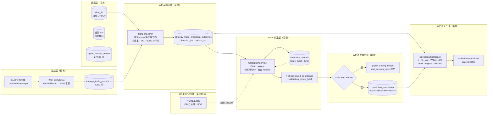
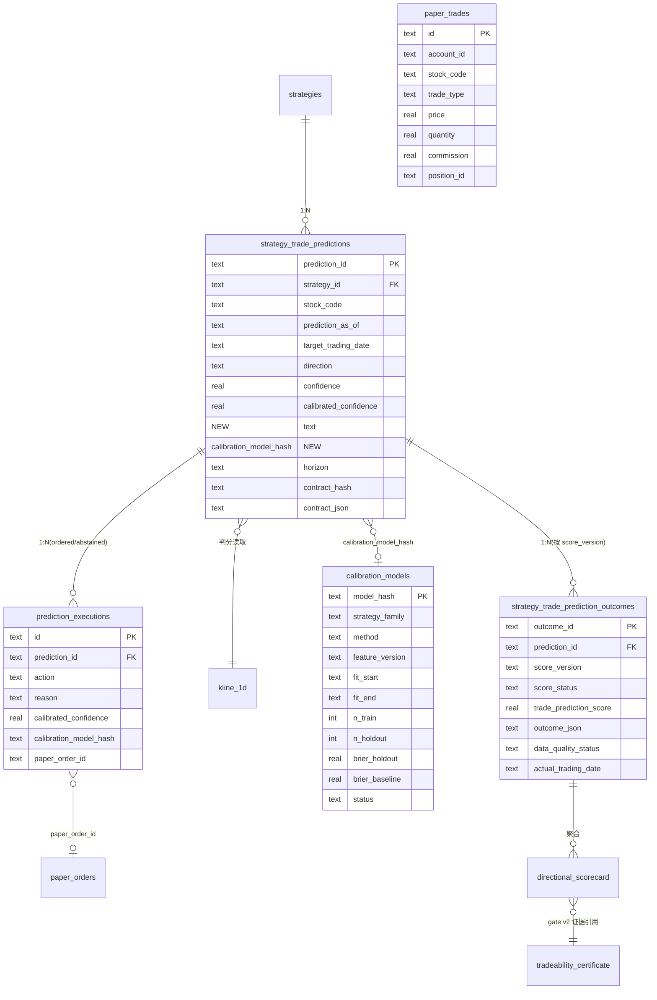
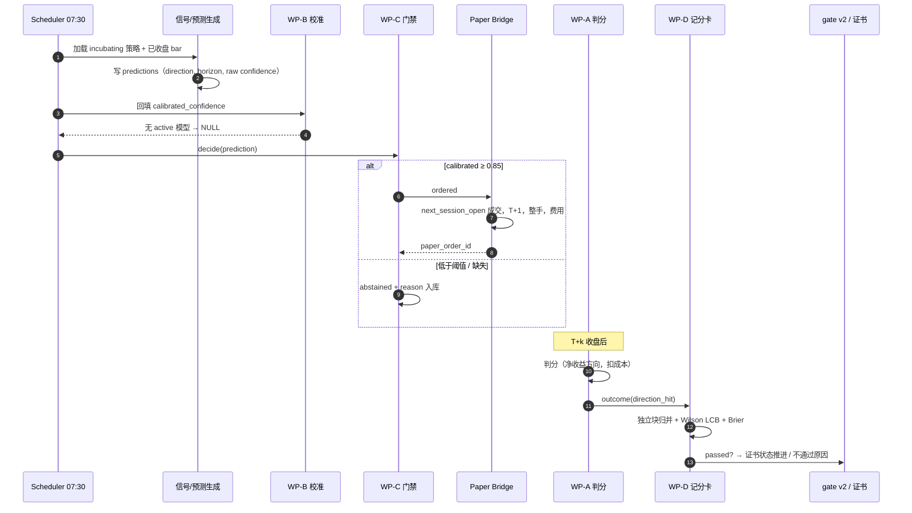
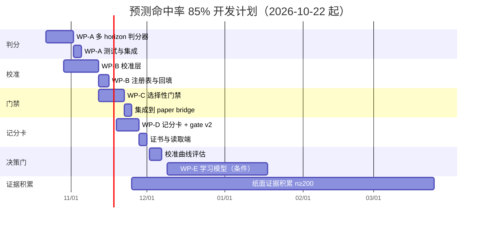

# 预测命中率 ≥85% 详细开发方案

| 项 | 内容 |
|---|---|
| 文档版本 | v2（详细设计，可执行） |
| 基线日期 | 2026-10-21 |
| 适用系统 | AIASK Strategy Factory + akshare-mcp incubation_factory + aiask-quant-core |
| 运行环境 | `/opt/miniconda3/envs/aiask/bin/python`（conda `aiask`） |
| 目标 | 模拟盘中股票方向预测命中率 ≥85%，且可测量、可校准、可选择、可审计 |
| 边界 | A 股日频；只多/现金；收盘信号 → 下一交易时段执行；不接券商、不启用真实资金 |
| 配套可视化 | `docs/prediction-hitrate-85.html`（架构/流程/数据关系图） |

> **诚实声明（先读）**：本方案不承诺 85% 一定可达。它保证的是：如果证据达到 85%，系统会以不可绕过的方式判定并留痕；如果达不到，系统会给出实测命中率、置信区间、缺口原因和下一次重评所需的数据里程碑。任何声称「保证 85%」的系统都在隐瞒分布。

---

## 目录

1. [需求定义](#1-需求定义)
2. [现状证据](#2-现状证据)
3. [总体架构](#3-总体架构)
4. [数据模型与 DDL](#4-数据模型与-ddl)
5. [详细设计](#5-详细设计)
   - 5.1 WP-A 多 horizon 判分器
   - 5.2 WP-B 校准层
   - 5.3 WP-C 选择性出手门禁
   - 5.4 WP-D 方向记分卡与 gate v2
   - 5.5 WP-E 学习型方向模型（条件启动）
6. [端到端流程](#6-端到端流程)
7. [开发周期](#7-开发周期)
8. [测试与验收](#8-测试与验收)
9. [发布、监控与回滚](#9-发布监控与回滚)
10. [风险与不包含项](#10-风险与不包含项)

---

## 1. 需求定义

### 1.1 原始需求

> 在模拟盘当中模拟交易的时候预测股票的走势达到 85% 以上。

### 1.2 需求拆解：四条可交付契约

| 编号 | 契约 | 可验证内容 | 当前状态 |
|---|---|---|---|
| R1 | **可测量** | 每条预测都有「预测 → 结算」判分：按 horizon 净收益方向、扣双边成本、T+1、缺数据 null + 原因码 | ❌ 88% 不可判分，0 行 `score_status=ok` |
| R2 | **可达成** | 存在有频率含义的概率来源（校准后的 confidence），不是规则常量 | ❌ `calibrated_confidence` 仅 1/231 行有值 |
| R3 | **可选择** | 只在高置信时出手，低置信记录 abstain；否则全量命中率由市场决定 | ❌ paper bridge 发单不读 confidence |
| R4 | **可审计** | 判据预注册；独立样本归并；与 candidate hash 绑定；输入变更即失效；不达标不降门槛 | ⚠️ 有骨架（gate v1 + 证书），但预测门禁开关被硬编码关闭 |

### 1.3 目标指标的可判定定义（冻结，改动需升 gate 版本）

| 项 | 定义 |
|---|---|
| 指标名 | `directional_hit_rate` |
| 计算 | 独立可判分预测中方向命中数 ÷ 独立可判分预测总数 |
| 命中口径 | 自 `prediction_as_of` 的**次一交易日开盘**入场，horizon 末交易日收盘出场；净收益（扣双边成本）方向与预测方向一致；持平带 0.2% |
| 独立样本 | 最小单元 = `(stock_code, prediction_as_of)` 时间块；同块多策略/多 horizon 只计 1 个；跨块自相关用 block bootstrap 处理 |
| 达标条件 | `n_independent ≥ 200` ∧ `Wilson 95% LCB > 0.80` ∧ `Brier < 0.25`（0.5 常数基线） ∧ `regime_coverage ≥ 2` |
| 并行判据 | `profit_factor ≥ 1.5` ∧ `净收益 LCB > 0`（防止「高胜率、烂盈亏比」） |
| 不达标 | 报告实测值 + LCB + 距标差值 + 下一里程碑；**不降阈值、不拿点估计冒充** |

### 1.4 为什么必须是「校准 + 选择性」

全量规则信号的方向命中率实测 45.6–47.9%（1d–20d），日级方向业界最优约 55–65%。要让**被交易的子集**达到 85%，唯一路径是：模型给出有频率含义的概率 → 校准 → 只在 `P(方向对) ≥ 0.85` 时出手。交易频率会大幅下降，这是代价，不是缺陷。

---

## 2. 现状证据

### 2.1 数据库实测（`~/.aiask/data/db/akshare_mcp.sqlite3`，只读，2026-10-21）

| 表 | 行数 | 关键实测 |
|---|---:|---|
| `strategy_trade_predictions` | 8,932 | 8,932 个策略各 1 条；`direction`：up 4,269 / down 3,823 / neutral 840；`confidence` 有 3,519 条恰为 `0.675807`；`contract_source` 全为 `derived_from_legacy_contract` |
| `strategy_trade_prediction_outcomes` | 1,572 | 0 行 `score_status=ok`；`partial_daily_only` 186、`partial_intraday_missing` 786、`pending_market_data` 600；`direction_hit`：1=61、0=125、null=1,386 |
| `signal_forward_returns` | 27,699 | P(ret>0)：1d 46.7%、5d 47.9%、10d 46.1%、20d 45.6%、30d 26.9%（n=402，均值 −2.67%） |
| `strategy_signal_evidence` | 231 | `raw_confidence` 1 行、`calibrated_confidence` 1 行、`proxy_only` 172 行 |
| `paper_nav` | 3,164 | 1,767 账户，单账户最多 13 天（均值 1.79） |
| `paper_trades` | 597 | 全库已闭合 round-trip 61 笔；0 个账户 ≥30 笔 |

### 2.2 代码证据（现状判断的每一行出处）

| 位置 | 内容 | 状态 |
|---|---|---|
| `packages/akshare-mcp/src/akshare_mcp/services/incubation_factory/trade_prediction_verifier.py:257` | `_daily_outcome`：目标日 open→close、持平带 0.2%、0.55/0.25/0.20 打分 | 已有，仅日级 |
| 同上 `:439` | `IntradayReplayService` 日内回放；实测 0 行 scored | 骨架，缺日内数据 |
| 同上 `:557` | `TradePredictionDailyVerifier.verify_pending` 批量判分入口 | 已有 |
| `.../hit_rate_reporter.py:54` | 命中率仪表盘（整体/按族/按阶段/regime 矩阵/趋势） | 已有 |
| `.../forward_verifier.py:407` | `_compute_skill_lcb`：Wilson 下界 − 0.5（n<5 返回 0） | 可复用 |
| `packages/strategy-factory/.../application/trade_prediction_promotion_gate.py:15-17` | `min_sample_n=30`、`min_score_lcb_95=0.55`、v2 聚合 | 已有，仅诊断 |
| `packages/strategy-factory/.../application/_runtime_toggles.py:229` | 门禁开关硬编码 `return False` | 关闭 |
| `packages/strategy-factory/.../application/research/runner.py:545` | confidence 兜底 0.45（`target_injection_diagnostic_fallback`） | 非概率 |
| `packages/aiask-quant-core/.../storage/sqlite/strategy_trade_prediction.py:145/331/486/564` | save prediction / save outcome / summarize / matrix | 可复用 |
| `packages/strategy-factory/.../infrastructure/factory_schema_ddl.py:238` | 预测/结果表 DDL 与索引 | 可复用 |
| `packages/strategy-factory/.../application/research/paper_trading_bridge.py:352` | `run_daily_signals`：逐标的已收盘 bar、幂等 key、候选哈希绑定 | 可复用 |
| 同上 `:506` | `evaluate_promotion`：60 有效交易日、30 round-trip、阈值实际执行 | 已实现 |
| `packages/strategy-factory/.../application/tradeability_gate.py:32` | `TRADEABILITY_THRESHOLDS`、gate v1、证书构建/失效 | 扩展点 |

### 2.3 结论

现有链路「生成 → 记录」完整，「判分 → 校准 → 出手」缺失。本方案补齐后半段，并把 85% 预注册成 gate v2 判据。

---

## 3. 总体架构



**组件职责表**

| 组件 | 包 | 新增/修改 | 职责 |
|---|---|---|---|
| `horizon_scorer.py` | akshare-mcp | 新增 | 多 horizon 判分、成本、T+1、null 原因码 |
| `trade_prediction_verifier.py` | akshare-mcp | 修改 | `verify_pending` 按 horizon 路由 |
| `calibration.py` | aiask-quant-core | 新增 | Platt/isotonic、Brier、可靠性曲线、模型注册 |
| `calibration_models` | aiask-quant-core DDL | 新增表 | 模型版本与封存验证结果 |
| `selective_gate.py` | strategy-factory | 新增 | 高置信才发单、abstain 记录 |
| `paper_trading_bridge.py` | strategy-factory | 修改 | 发单前调用门禁 |
| `directional_scorecard.py` | akshare-mcp | 新增 | 独立样本归并、LCB、Brier、regime、abstain |
| `tradeability_gate.py` | strategy-factory | 修改 | gate v2 阈值与证书字段 |
| `prediction_executions` | strategy-factory DDL | 新增表 | 出手/不出手动作审计 |

---

## 4. 数据模型与 DDL



### 4.1 DDL（幂等，沿用 `factory_schema_ddl.py` 的 `IF NOT EXISTS` 模式）

```sql
-- 预测表：新增校准列
ALTER TABLE strategy_trade_predictions ADD COLUMN IF NOT EXISTS calibrated_confidence REAL;
ALTER TABLE strategy_trade_predictions ADD COLUMN IF NOT EXISTS calibration_model_hash TEXT;

-- 校准模型注册表
CREATE TABLE IF NOT EXISTS calibration_models (
    model_hash       TEXT PRIMARY KEY,
    strategy_family  TEXT NOT NULL,
    method           TEXT NOT NULL,            -- platt | isotonic
    feature_version  TEXT NOT NULL,
    fit_start        TEXT NOT NULL,
    fit_end          TEXT NOT NULL,            -- 封存切分点（含）
    n_train          INTEGER NOT NULL,
    n_holdout        INTEGER NOT NULL,
    brier_holdout    REAL,
    brier_baseline   REAL NOT NULL,            -- 0.25：p=0.5 常数基线
    ece_holdout      REAL,
    status           TEXT NOT NULL,            -- active | rejected | retired
    created_at       TEXT DEFAULT CURRENT_TIMESTAMP
);
CREATE INDEX IF NOT EXISTS idx_calibration_models_family
    ON calibration_models(strategy_family, status, fit_end DESC);

-- 执行动作表：ordered 与 abstained 都是样本
CREATE TABLE IF NOT EXISTS prediction_executions (
    id                     TEXT PRIMARY KEY,
    prediction_id          TEXT NOT NULL,
    action                 TEXT NOT NULL CHECK (action IN ('ordered','abstained')),
    reason                 TEXT,
    calibrated_confidence  REAL,
    calibration_model_hash TEXT,
    paper_order_id         TEXT,
    created_at             TEXT DEFAULT CURRENT_TIMESTAMP
);
CREATE INDEX IF NOT EXISTS idx_prediction_executions_prediction
    ON prediction_executions(prediction_id);
CREATE INDEX IF NOT EXISTS idx_prediction_executions_action
    ON prediction_executions(action, created_at DESC);

-- 结果表：保证 (prediction_id, score_version) 幂等
CREATE UNIQUE INDEX IF NOT EXISTS uq_prediction_outcome_version
    ON strategy_trade_prediction_outcomes(prediction_id, score_version);
```

### 4.2 写入规则

- `outcome_id = sha256(prediction_id + "|" + score_version)[:32]`，重复判分走 upsert，不新增行。
- 所有日期由数据推导（`max(kline date)`），**不使用墙钟日期**。
- 缺数据一律 `NULL` + 稳定原因码，禁止写 0。
- `neutral` 方向的预测不进入方向分母，但 outcome 仍落库并标 `neutral_direction_excluded`。

---

## 5. 详细设计

### 5.1 WP-A 多 horizon 判分器

#### 5.1.1 目标

把当前 88% 的 null 判分转成可判分，并为 5d/10d/15d/20d 预测提供「T+1 入场、horizon 末出场」的净收益方向判分。

#### 5.1.2 新文件

`packages/akshare-mcp/src/akshare_mcp/services/incubation_factory/horizon_scorer.py`

```python
"""Horizon-aware directional scoring for frozen trade predictions.

Fail-closed: missing bars, suspended sessions, or an incomplete horizon produce
direction_hit=None with a stable reason; they are never coerced into 0/1.
"""
from __future__ import annotations

from dataclasses import dataclass
from datetime import date
from typing import Any, Mapping, Sequence

HORIZON_SCORE_VERSION = "trade_prediction_score_horizon_v1"

DEFAULT_ROUND_TRIP_COST = 0.0021   # 佣金 0.0003×2 + 印花税 0.0005 + 滑点 0.0005×2
DEFAULT_FLAT_BAND = 0.0020
DEFAULT_STOP_LOSS = 0.08


@dataclass(frozen=True)
class HorizonScoringConfig:
    round_trip_cost: float = DEFAULT_ROUND_TRIP_COST
    flat_band: float = DEFAULT_FLAT_BAND
    stop_loss: float = DEFAULT_STOP_LOSS
    max_skipped_sessions: int = 20   # 超过则视为无法闭环

    @classmethod
    def from_contract(cls, contract: Mapping[str, Any]) -> "HorizonScoringConfig":
        def _f(key: str, default: float) -> float:
            value = contract.get(key)
            try:
                return float(value) if value is not None else default
            except (TypeError, ValueError):
                return default
        band = _f("flat_threshold_pct", DEFAULT_FLAT_BAND)
        if band > 1.0:
            band /= 100.0
        return cls(
            round_trip_cost=max(0.0, _f("round_trip_cost", DEFAULT_ROUND_TRIP_COST)),
            flat_band=max(0.0, band),
            stop_loss=_f("stop_loss", DEFAULT_STOP_LOSS) or DEFAULT_STOP_LOSS,
        )


class HorizonScorer:
    """Score one prediction against closed daily bars."""

    def score(
        self,
        prediction: Mapping[str, Any],
        bars: Sequence[Mapping[str, Any]],
        *,
        config: HorizonScoringConfig | None = None,
    ) -> dict[str, Any]:
        ...
```

#### 5.1.3 算法（逐步）

1. **解析 horizon**：`horizon` 形如 `"5d"`；非法/缺失 → `direction_hit=None, reason="horizon_invalid"`。
2. **解析方向**：`up | down | neutral`；未知 → `direction_unrecognized`。
3. **`neutral`** → `direction_hit=None, score_status="neutral_direction_excluded"`，不进入方向分母。
4. **排序与去重 bar**：按 `date` 升序，同日只保留一根（后到覆盖），仅用 `is_closed != False` 的 bar。
5. **入场 bar**：第一个 `date > prediction_as_of` 的交易日（严格下一交易日）。不存在 → `entry_bar_missing`；`open` 缺失/≤0 → `entry_open_missing`（**不回落到 close**）。
6. **出场 bar**：自入场 bar 起第 `k` 根（`entry_index + k - 1`）。不足 → `horizon_incomplete`，记录 `available_bars`。
7. **停牌处理**：窗口内缺失的交易日数 ≤ `max_skipped_sessions` 时按交易日序列继续；超过 → `horizon_incomplete_suspension`。记录 `skipped_sessions`。
8. **成本**：`net = (exit_close * (1 - sell_cost) / (entry_open * (1 + buy_cost))) - 1`，默认双边合计 0.21%。
9. **方向命中**：`up: net > flat_band`；`down: net < -flat_band`；`flat: |net| <= flat_band`。
10. **风险代理**：`adverse = max(0, (entry_open - min_low)/entry_open)`（up）或 `max(0, (max_high - entry_open)/entry_open)`（down）；`risk_score = clamp(1 - adverse/stop_loss, 0, 1)`。
11. **目标触达**：若契约含 `target_low/target_high`，窗口内 `high >= low_target and low <= high_target`；未给 → `target_touch=None`（**不当作 0 分**，综合分记为 `None`）。
12. **综合分**（仅在 direction_hit 与 target_touch 均可测时计算）：`0.55*direction_hit + 0.25*target_touch + 0.20*risk_score`；否则 `None`。
13. **输出**：

```json
{
  "prediction_id": "…",
  "strategy_id": "…",
  "stock_code": "600519",
  "score_version": "trade_prediction_score_horizon_v1",
  "score_status": "ok",
  "data_quality_status": "ok",
  "direction_hit": true,
  "trade_prediction_score": 0.83,
  "actual_trading_date": "2026-11-04",
  "outcome_json": {
    "direction": "up",
    "horizon_days": 10,
    "entry_date": "2026-10-23",
    "entry_price": 1680.0,
    "exit_date": "2026-11-04",
    "exit_price": 1725.5,
    "gross_return": 0.02708,
    "net_return": 0.02498,
    "cost": 0.0021,
    "flat_band": 0.002,
    "skipped_sessions": 0,
    "target_touch": null,
    "risk_proxy_score": 0.91,
    "derived": false,
    "config_version": "horizon_scoring.v1"
  }
}
```

#### 5.1.4 与现有判分器集成

修改 `trade_prediction_verifier.py`：

```python
async def verify_pending(self, db, *, persist=True, ...):
    for prediction in pending:
        horizon = _parse_horizon(prediction.get("horizon"))
        if horizon and horizon > 1:
            bars = await _load_closed_daily_bars(db, prediction["stock_code"], ...)
            outcome = HorizonScorer().score(prediction, bars)
        else:
            outcome = await self._score_daily(prediction, db)   # 现有 _daily_outcome
        if persist:
            await db.save_strategy_trade_prediction_outcome(outcome)
```

存储层 `save_strategy_trade_prediction_outcome` 改为 upsert（按唯一索引 `(prediction_id, score_version)`）。

#### 5.1.5 验收

- 可判分率（`direction_hit IS NOT NULL` ÷ 到期预测）≥ 70%，剩余 null 全部来自真实停牌/缺 bar。
- 同一 prediction 重跑不新增 outcome 行。
- 5d/10d/15d/20d 都有判分样本。

---

### 5.2 WP-B 校准层

#### 5.2.1 目标

把规则 confidence 映射成有频率含义的 `calibrated_confidence`，并用封存 holdout 证明映射有效；无有效模型时保持 `None`（fail-closed）。

#### 5.2.2 新文件

`packages/aiask-quant-core/src/aiask_quant_core/calibration.py`

```python
from __future__ import annotations

from dataclasses import dataclass
from typing import Any, Sequence

import numpy as np

EPS = 1e-9
BASELINE_BRIER = 0.25   # p=0.5 常数预测的 Brier 分数


@dataclass(frozen=True)
class CalibrationConfig:
    method: str = "platt"              # platt | isotonic
    feature_version: str = "calibration_features.v1"
    min_train: int = 100               # 独立块下限
    min_holdout: int = 50
    holdout_fraction: float = 0.3
    purge_blocks: int = 1              # 切分点两侧各丢弃的块数
    l2: float = 1e-3


@dataclass(frozen=True)
class CalibrationSample:
    block_key: str                      # (stock_code, prediction_as_of)
    as_of: str
    raw_confidence: float | None
    horizon_days: int
    family: str
    hit: int                            # 0/1


def brier_score(probabilities: Sequence[float], hits: Sequence[int]) -> float:
    p = np.asarray(probabilities, dtype=float)
    y = np.asarray(hits, dtype=float)
    if p.size == 0 or p.size != y.size:
        raise ValueError("brier_score requires equal non-empty arrays")
    return float(np.mean((p - y) ** 2))


def reliability_curve(
    probabilities: Sequence[float],
    hits: Sequence[int],
    *,
    bins: int = 10,
) -> list[dict[str, Any]]:
    ...


def fit_platt(samples: Sequence[CalibrationSample], config: CalibrationConfig) -> dict[str, Any]:
    """Return model payload with coefficients, metrics, and a stable model_hash."""


def fit_isotonic(samples: Sequence[CalibrationSample], config: CalibrationConfig) -> dict[str, Any]:
    """PAVA monotonic fit; falls back to rejection when sample is insufficient."""


def apply_model(model: dict[str, Any], samples: Sequence[CalibrationSample]) -> list[float]:
    ...
```

#### 5.2.3 样本构造（独立块）

- 从 `strategy_trade_prediction_outcomes`（`score_version=horizon_v1`、`direction_hit IS NOT NULL`、`data_quality_status=ok`）与 `strategy_trade_predictions` join。
- 按 `(stock_code, prediction_as_of)` 归并：同块多条预测取 `prediction_id` 字典序最小者（确定性、无选择偏差）；块内其余预测不计入训练。
- 特征（v1，仅预测时可得）：
  1. `raw_confidence`（缺失 → 用族中位数并置 `confidence_imputed=1`）
  2. `log1p(horizon_days)`
  3. `family` one-hot（族数 ≤ 20，超出归入 `other`）
- 标签：`direction_hit`（neutral 不进入）。

#### 5.2.4 时间序切分与封存

1. 按 `as_of` 升序排序独立块。
2. 末尾 30% 为 holdout；切分点两侧各 purge `purge_blocks=1` 个块（默认 1 个交易日块），防止边界泄漏。
3. 训练集拟合，holdout 只做一次评估；**holdout 不参与特征选择或调参**。
4. 记录 `fit_end = max(as_of of train)`。

#### 5.2.5 模型与注册

- Platt：`P = sigmoid(a * logit(x) + b)`，对 `[raw_confidence, log_horizon, family_onehot]` 做 L2 逻辑回归；`a` 初始化为 1、`b` 为 0。
- Isotonic：PAVA，要求 `n_train ≥ 200` 且训练集按概率单调可分；否则拒绝。
- `model_hash = sha256(json(model_params, feature_version, fit_end, data_snapshot_hash))[:32]`。
- 写 `calibration_models`：`status=active` 需同时满足：
  - `brier_holdout < 0.25`（优于 0.5 常数基线）
  - `brier_holdout < brier_train + 0.05`（无明显过拟合）
  - `n_holdout >= 50`
  - 可靠性曲线每个 `n>=20` 的 bin 偏差 ≤ 0.10
  - 否则 `status=rejected`，原因码落库（`brier_not_better_than_baseline` / `holdout_too_small` / `reliability_gap` / `overfit_gap`）

#### 5.2.6 回填

```python
async def apply_active_models(db, predictions: list[dict]) -> dict[str, int]:
    """按 family 取 active 模型，批量写 calibrated_confidence / calibration_model_hash。"""
```

- 无 active 模型 → 该族预测 `calibrated_confidence = NULL`，`calibration_model_hash = NULL`。
- 回填幂等：同一 `(prediction_id, model_hash)` 重复执行结果一致。
- 校准分截断到 `[0.01, 0.99]`，避免 0/1 极端值。

#### 5.2.7 验收

- 已知概率源（真实 0.9）→ 校准输出 ≈0.9，Brier 显著低于 0.25。
- 训练集与 holdout 时间不重叠；跨越封存点的模型被拒绝。
- 样本不足（<100 独立块）→ 拒绝拟合，不产出模型。
- 无 active 模型时预测的 `calibrated_confidence` 为 `None`（不得回填 0.45）。

---

### 5.3 WP-C 选择性出手门禁

#### 5.3.1 目标

只在 `calibrated_confidence ≥ 0.85` 时发纸面单；其余记录 abstain。任何缺失都 fail-closed（不交易）。

#### 5.3.2 新文件

`packages/strategy-factory/src/strategy_factory/application/research/selective_gate.py`

```python
from __future__ import annotations

from dataclasses import dataclass
from typing import Any, Mapping

MIN_CALIBRATED_CONFIDENCE = 0.85

ABSTAIN_REASONS = frozenset({
    "prediction_missing",
    "calibration_unavailable",
    "calibration_model_not_active",
    "below_threshold",
    "neutral_direction",
    "invalid_horizon",
})


@dataclass(frozen=True)
class GateDecision:
    action: str                 # ordered | abstained
    reason: str | None
    calibrated_confidence: float | None
    calibration_model_hash: str | None


def decide(
    prediction: Mapping[str, Any] | None,
    *,
    min_confidence: float = MIN_CALIBRATED_CONFIDENCE,
) -> GateDecision:
    if not prediction:
        return GateDecision("abstained", "prediction_missing", None, None)
    if str(prediction.get("direction") or "").lower() not in {"up", "down"}:
        return GateDecision("abstained", "neutral_direction", None, None)
    if not prediction.get("horizon"):
        return GateDecision("abstained", "invalid_horizon", None, None)
    model_hash = prediction.get("calibration_model_hash")
    if not model_hash:
        return GateDecision("abstained", "calibration_unavailable", None, None)
    value = prediction.get("calibrated_confidence")
    try:
        confidence = float(value)
    except (TypeError, ValueError):
        return GateDecision("abstained", "calibration_unavailable", None, model_hash)
    if confidence < min_confidence:
        return GateDecision("abstained", "below_threshold", confidence, model_hash)
    return GateDecision("ordered", None, confidence, model_hash)
```

#### 5.3.3 集成点

修改 `paper_trading_bridge.py::run_daily_signals`：

1. 生成信号后、调用 `_place_paper_order` 前，读取该 `(strategy_id, code, signal_date)` 对应的预测（按 `prediction_as_of == 上一交易日`、`target_trading_date == 当日` 匹配）。
2. `decision = decide(prediction)`。
3. `ordered` → 发单，并在 `prediction_executions` 写 `action=ordered, paper_order_id=...`。
4. `abstained` → **不发单**，写 `action=abstained, reason=...`。
5. 返回值新增 `abstain` 字段；scheduler 汇总 `abstain_count`、`abstain_reasons`。

#### 5.3.4 幂等与并发

- `prediction_executions.id = sha256(prediction_id + action + date)[:32]`，重复执行 upsert。
- 同一预测一天只允许一个 ordered 记录；若已存在 ordered，则直接返回该 `paper_order_id`（不重复下单）。

#### 5.3.5 验收

- `calibrated=0.84` → abstained（`below_threshold`），无 paper 单。
- `calibrated=0.85` → ordered。
- 无校准模型 → abstained（`calibration_unavailable`）。
- `neutral` → abstained（`neutral_direction`）。
- abstain 全部入库，可按原因统计。

---

### 5.4 WP-D 方向记分卡与 gate v2

#### 5.4.1 目标

把命中率、独立样本量、置信区间、校准质量、市场状态覆盖与 abstain 率做成一张可复核记分卡，并接入预注册门禁与证书。

#### 5.4.2 新文件

`packages/akshare-mcp/src/akshare_mcp/services/incubation_factory/directional_scorecard.py`

```python
from __future__ import annotations

import math
from typing import Any, Iterable, Mapping

SCORECARD_VERSION = "directional_scorecard.v1"


def wilson_lcb95(hits: int, n: int) -> float | None:
    if n <= 0:
        return None
    z = 1.96
    p = hits / n
    denominator = 1.0 + z * z / n
    center = (p + z * z / (2.0 * n)) / denominator
    margin = z * math.sqrt((p * (1.0 - p) + z * z / (4.0 * n)) / n) / denominator
    return max(0.0, min(1.0, center - margin))


def independent_blocks(outcomes: Iterable[Mapping[str, Any]]) -> list[Mapping[str, Any]]:
    """按 (stock_code, prediction_as_of) 归并，取 prediction_id 字典序最小者。"""


def summarize_directional(
    outcomes: Iterable[Mapping[str, Any]],
    executions: Iterable[Mapping[str, Any]] = (),
    *,
    calibrated_probabilities: Mapping[str, float] | None = None,
) -> dict[str, Any]:
    ...
```

#### 5.4.3 指标定义

| 指标 | 定义 |
|---|---|
| `n_independent` | 独立块数（`(stock_code, prediction_as_of)` 去重） |
| `hits` | `direction_hit=True` 的独立块数 |
| `hit_rate` | `hits / n_independent` |
| `wilson_lcb95` | 上述公式；`n=0` → `None` |
| `brier` | 若存在校准分：`mean((p - hit)^2)`；否则 `None` + `brier_unavailable` |
| `regime_coverage` | 至少 10 个独立块的 regime 数（复用 `hit_rate_by_regime` 维度） |
| `abstain_rate` | `abstained / (ordered + abstained)`；无执行记录 → `None` |
| `horizon_coverage` | 有判分的 horizon 集合 |
| `excluded_neutral` | neutral 方向被排除的条数 |
| `excluded_null` | `direction_hit IS NULL` 条数（按原因分组） |

#### 5.4.4 记分卡输出

```json
{
  "scorecard_version": "directional_scorecard.v1",
  "generated_at": "2026-11-20T07:40:00+08:00",
  "data_snapshot_hash": "…",
  "n_independent": 214,
  "hits": 183,
  "hit_rate": 0.8551,
  "wilson_lcb95": 0.8023,
  "brier": 0.128,
  "regime_coverage": 2,
  "horizon_coverage": [5, 10, 20],
  "abstain_rate": 0.91,
  "excluded_neutral": 42,
  "excluded_null": {"horizon_incomplete": 3, "entry_bar_missing": 1},
  "thresholds": {
    "min_n": 200,
    "min_lcb": 0.80,
    "max_brier": 0.25,
    "min_regimes": 2
  },
  "passed": true,
  "reason_codes": []
}
```

#### 5.4.5 gate v2 阈值（`TRADEABILITY_THRESHOLDS` 新版本）

```python
TRADEABILITY_GATE_VERSION = "strategy_factory.tradeability_gate.v2"
TRADEABILITY_THRESHOLDS = {
    **TRADEABILITY_THRESHOLDS_V1,          # 保留原有 paper / backtest 判据
    "directional_hit_rate_lcb95_min": 0.80,
    "directional_min_independent_predictions": 200,
    "directional_max_brier": 0.25,
    "directional_min_regime_coverage": 2,
    "selective_trading_min_calibrated_confidence": 0.85,
    "calibration_min_holdout_brier_gain": 0.02,
}
```

- 阈值改动必须：升 `TRADEABILITY_GATE_VERSION` + 在 `docs/STRATEGY_TRADEABILITY_STANDARD.md` 记录独立校准证据。
- 旧证书经 `validate_tradeability_certificate_freshness` 检测 `gate_version` 不一致 → `certificate_stale_gate_version`。

#### 5.4.6 证书字段扩展

```json
{
  "directional_scorecard": { "...": "上述记分卡" },
  "directional_gate": {
    "gate_version": "…v2",
    "passed": true,
    "reason_codes": [],
    "threshold_profile": { "...": "冻结阈值" }
  }
}
```

#### 5.4.7 里程碑脚本

`scripts/check_hitrate_milestones.py`（`check_*.py` 命名，不被 pytest 收集）：

- 只读连接运行库，输出 `n=50/100/150/200` 各档状态。
- 每次运行打印：`n_independent`、`hit_rate`、`wilson_lcb95`、`brier`、`regime_coverage`、`abstain_rate`、距下一档差多少。
- 数据不足时退出码 0 并打印 `insufficient_evidence`，不伪造通过。

---

### 5.5 WP-E 学习型方向模型（条件启动）

#### 5.5.1 决策门

WP-B 完成后检查校准曲线：

- `calibrated_confidence ≥ 0.85` 段的 holdout 实测命中率 `≥ 65%` → 启动 WP-E。
- `< 65%` → 报告「规则信号无可校准的概率结构，85% 在本数据上不可达」，停止投入，记录结论与证据。

#### 5.5.2 设计要点

| 项 | 方案 |
|---|---|
| 特征 | 量价形态（N 日收益/波动/换手）、财务快照、事件窗口；**全部预测时点可得** |
| 标签 | horizon 净收益方向（复用 WP-A 判分） |
| 模型 | 梯度提升二分类（LightGBM 或 sklearn `HistGradientBoostingClassifier`） |
| 切分 | 时间序 walk-forward，≥3 个连续 OOS 窗口；purge/embargo 按 horizon |
| 防泄漏 | 点时数据校验；特征时间戳 ≤ `prediction_as_of`；purged k-fold 复用 `validation.py` |
| 产出 | 概率 → WP-B 校准 → WP-C 门禁 |
| 失败 | OOS 样本不足 / 计算失败 / 泄漏检测命中 → fail-closed，不产出模型 |

---

## 6. 端到端流程



**每日调度时序**

1. 07:30 纸面周期加载 incubating 策略，逐标的取最近 120 根已收盘 bar。
2. 生成预测与信号，写 `strategy_trade_predictions`（confidence 为规则值）。
3. WP-B 回填校准分；无模型则保持 NULL。
4. WP-C 对每条预测做出手判定；ordered → 发单，abstained → 入库。
5. 收盘后写 NAV；到期预测进入 WP-A 判分。
6. WP-D 聚合；里程碑脚本输出。

---

## 7. 开发周期



| 阶段 | 日期 | 交付物 | 退出条件 |
|---|---|---|---|
| WP-A | 10/22–11/04 | `horizon_scorer.py` + 测试 | 可判分率 ≥70%；null 仅剩真实数据缺口 |
| WP-B | 10/29–11/18 | `calibration.py` + `calibration_models` | holdout Brier 门禁跑通；校准分可回填 |
| WP-C | 11/12–11/25 | `selective_gate.py` + `prediction_executions` | 低置信 zero-order；abstain 全入库 |
| WP-D | 11/19–12/02 | 记分卡 + gate v2 + 证书字段 | 记分卡可运行；阈值冻结并写入证书 |
| 决策门 | 12/02–12/09 | 校准曲线报告 | ≥65% → 启动 WP-E；否则记录不可达 |
| WP-E | 12/09–01/20 | OOS 方向模型 | OOS + 校准 + 泄漏检测通过 |
| 证据积累 | 11/25 起 | 每日记分卡 | n≥200、LCB>0.80、Brier<0.25、≥2 regimes |

> **关键路径是证据积累，不是编码。** 选择性交易下每天可能 0–2 笔，n=200 独立判分需要数月真实交易日。工程可以在 6 周内完成，85% 的判定只能等数据。

---

## 8. 测试与验收

### 8.1 测试文件与用例

| 文件 | 用例 | 断言 |
|---|---|---|
| `packages/akshare-mcp/tests/test_horizon_scorer.py` | `test_up_hit_after_costs` | 构造 10 根 bar，净收益 +2.5% → `direction_hit=True` |
| 同上 | `test_small_gain_within_flat_band_is_not_a_hit` | 净收益 +0.1% → `False` |
| 同上 | `test_entry_uses_next_session_open_not_same_day_close` | 同日 close 上涨但次日 open 低开 → 按次日 open 计算 |
| 同上 | `test_missing_open_is_null_not_close_fallback` | 次日 `open` 缺失 → `None` + `entry_open_missing` |
| 同上 | `test_insufficient_bars_is_horizon_incomplete` | 只有 3 根 → `None` + `horizon_incomplete` |
| 同上 | `test_suspended_sessions_are_skipped_and_counted` | 缺 2 个交易日 → `skipped_sessions=2`，仍可判分 |
| 同上 | `test_neutral_direction_is_excluded_from_denominator` | `neutral` → `direction_hit=None` + `neutral_direction_excluded` |
| 同上 | `test_rerun_is_idempotent` | 同一 prediction 重跑 → outcome 行数不变 |
| `packages/aiask-quant-core/tests/test_calibration.py` | `test_platt_recovers_known_probability` | 已知 0.9 概率源 → 输出 ≈0.9，Brier < 0.15 |
| 同上 | `test_holdout_never_used_for_fitting` | 修改 holdout 标签 → 模型参数不变 |
| 同上 | `test_rejects_when_holdout_brier_not_better_than_baseline` | `status=rejected` + 原因码 |
| 同上 | `test_rejects_below_minimum_independent_blocks` | n<100 → 拒绝拟合 |
| 同上 | `test_model_hash_changes_with_fit_end_or_features` | 任一输入变化 → 哈希变化 |
| 同上 | `test_calibrated_values_are_clamped` | 输出 ∈ [0.01, 0.99] |
| `packages/strategy-factory/tests/test_selective_gate.py` | `test_below_threshold_abstains` | 0.84 → `abstained/below_threshold` |
| 同上 | `test_at_threshold_orders` | 0.85 → `ordered` |
| 同上 | `test_missing_calibration_abstains` | 无模型 → `abstained/calibration_unavailable` |
| 同上 | `test_neutral_abstains` | `neutral` → `abstained/neutral_direction` |
| 同上 | `test_abstain_is_persisted` | 执行表新增 1 行，reason 正确 |
| 同上 | `test_ordered_is_idempotent` | 重复调用 → 同一 `paper_order_id`，不重复下单 |
| `packages/akshare-mcp/tests/test_directional_scorecard.py` | `test_overlapping_predictions_count_once` | 同块 3 条 → `n_independent=1` |
| 同上 | `test_wilson_lcb_matches_reference` | n=200,hits=170 → LCB≈0.802（容差 1e-3） |
| 同上 | `test_brier_requires_calibrated_probabilities` | 无校准分 → `None` + `brier_unavailable` |
| 同上 | `test_regime_coverage_counts_blocks_not_rows` | 同 regime 多行 → 只算 1 |
| 同上 | `test_abstain_rate_from_executions` | ordered 10 / abstained 90 → 0.9 |
| 同上 | `test_failed_gate_lists_reason_codes` | n=150 → `insufficient_independent_samples` |
| `packages/strategy-factory/tests/test_gate_v2_certificate.py` | `test_gate_v2_requires_directional_scorecard` | 缺记分卡 → `research_only` |
| 同上 | `test_gate_version_change_invalidates_old_certificate` | v1 证书 → `certificate_stale_gate_version` |
| 同上 | `test_passing_scorecard_advances_but_never_enables_live` | 状态推进，`live_trading_enabled=False` |
| `packages/strategy-factory/tests/test_direction_model_oos.py` | `test_future_feature_is_rejected` | 含未来时间戳特征 → 拒绝训练 |
| 同上 | `test_oos_windows_do_not_overlap` | 3 个连续窗口，purge/embargo 生效 |
| 同上 | `test_insufficient_oos_samples_stays_research_only` | 样本不足 → 不产出可用模型 |

### 8.2 正向控制

- 合成 220 个独立块、真实命中率 0.88 的预测流 → 记分卡 `n=220`、`LCB>0.80`、`passed=true`，证书生成且状态推进。
- 已知 0.9 概率源 → 校准输出 ≈0.9，Brier < 0.15。
- 高置信真实信号 → 全部 ordered，无 abstain。

### 8.3 负向控制（必须被拒绝）

| 控制 | 期望 |
|---|---|
| 同标的同日重叠预测 | 归并后 n 不变 |
| 校准用封存点之后数据 | 模型 `rejected` |
| 无校准模型发单 | `abstained/calibration_unavailable` |
| 缺 bar / 停牌未闭环 | `direction_hit=None` + 原因码 |
| 旧 gate v1 证书 | `certificate_stale_gate_version` |
| 点估计 0.85 但 LCB 0.78 | 不通过，报告 `insufficient_lcb` |
| abstain 被丢弃 | 测试失败 |
| `neutral` 进入方向分母 | 测试失败 |

### 8.4 回归命令

```bash
cd packages/akshare-mcp      && /opt/miniconda3/envs/aiask/bin/python -m pytest -q
cd packages/aiask-quant-core && /opt/miniconda3/envs/aiask/bin/python -m pytest -q
cd packages/strategy-factory && /opt/miniconda3/envs/aiask/bin/python -m pytest -q
```

### 8.5 验收里程碑

| 里程碑 | 条件 | 报告内容 |
|---|---|---|
| M0 工程完成 | 三包全绿；记分卡可运行；证书可生成/失效 | 测试计数、变更文件清单 |
| M1 n=50 | 首批独立判分 | 实测 hit_rate、LCB、数据缺口 |
| M2 n=100 | 校准稳定性 | 可靠性曲线、regime 覆盖 |
| M3 n=200 | 正式判定 | 四项硬判据逐项结果 + 原因码 |
| M4 决策门 | 校准曲线高置信段 | ≥65% → 启动 WP-E；否则记录不可达 |

---

## 9. 发布、监控与回滚

### 9.1 数据库迁移

- 全部 DDL 幂等（`IF NOT EXISTS`），随 `factory_schema_ddl.py` 在应用启动时执行。
- 迁移在只读副本先验证；生产库只允许应用执行，不允许手工改表。
- 回滚：新增表和列可保留（不影响旧代码）；功能开关关闭即可停用。

### 9.2 功能开关

| 开关 | 默认 | 作用 |
|---|---|---|
| `STRATEGY_FACTORY_HORIZON_SCORING_ENABLED` | `true` | WP-A 判分 |
| `STRATEGY_FACTORY_CALIBRATION_ENABLED` | `true` | WP-B 回填 |
| `STRATEGY_FACTORY_SELECTIVE_GATE_ENABLED` | `false` → 观察期后 `true` | WP-C 发单门禁 |
| `STRATEGY_FACTORY_DIRECTIONAL_GATE_ENABLED` | `false` → 证据达标后 `true` | gate v2 硬阻断 |

发布顺序：先开 A（只写结果，不影响交易）→ 开 B（只回填校准分）→ 观察 2 周 → 开 C（开始选择性交易）→ 记分卡达标后开 D。

### 9.3 每日监控

`scripts/check_hitrate_milestones.py --read-only` 输出：

- 可判分率、`n_independent`、`hit_rate`、`Wilson LCB`、`Brier`、`regime_coverage`、`abstain_rate`
- 告警条件：
  - 可判分率 < 70% 连续 3 天
  - active 校准模型超过 30 天未重训
  - abstain 率 = 100% 连续 10 天（说明没有信号能达到阈值）
  - `n_independent` 连续 5 个交易日无增长

### 9.4 回滚

- 关闭 `STRATEGY_FACTORY_SELECTIVE_GATE_ENABLED` → 恢复全量发单（但仍由现有 paper 门槛约束）。
- 关闭 `STRATEGY_FACTORY_CALIBRATION_ENABLED` → 校准分不再回填，门禁自动 abstain（fail-closed）。
- 证书回滚：旧 gate 版本证书保留，读取端按版本判定 stale，不删除历史。

---

## 10. 风险与不包含项

### 10.1 风险

| 风险 | 影响 | 缓解 |
|---|---|---|
| 85% 统计上不可达 | 长期 0 交易 | 决策门提前终止 WP-E；报告不可达原因 |
| 选择性交易导致样本饥饿 | n=200 需数月 | 里程碑制、每日监控、不降阈值 |
| 重叠样本虚增 | 命中率虚高 | 独立块归并 + block bootstrap |
| 高胜率低盈亏比 | 命中率达标但不赚钱 | 并行 PF≥1.5、净收益 LCB>0 |
| 数据缺口（分钟 bar） | 判分 null | 补数据是独立工作包；不估算填充 |
| 校准过拟合 | holdout 失效 | 时间序切分 + purge + Brier/可靠性双门禁 |
| 泄漏 | 模型虚高 | 点时特征校验 + purged k-fold |

### 10.2 不包含项

- 实盘交易授权、券商 API、资金配置、收益承诺。
- 期货、融券、盘中策略（需各自市场规则）。
- 点时成分股/退市证券的大规模历史回补（独立数据工作包）。
- LLM 授予认证（LLM 只能生成候选与解释）。

### 10.3 最终交付物

1. 本方案文档（本文）。
2. WP-A/B/C/D 代码与行为测试。
3. gate v2 证书样例与失效演示。
4. 每日记分卡与里程碑报告。
5. 当前（未达标时）明确原因：实测 hit_rate、LCB、缺口样本数、下一里程碑。
